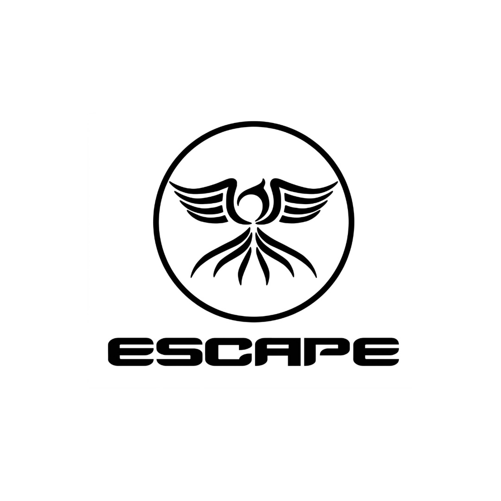
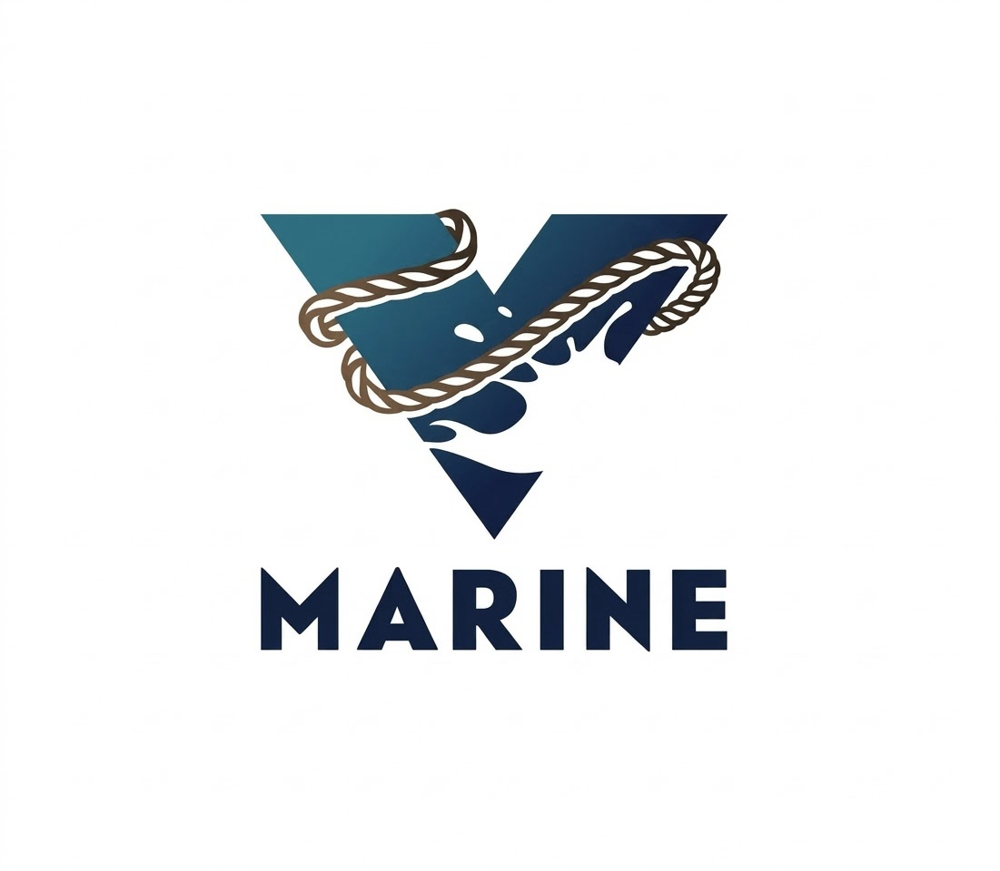
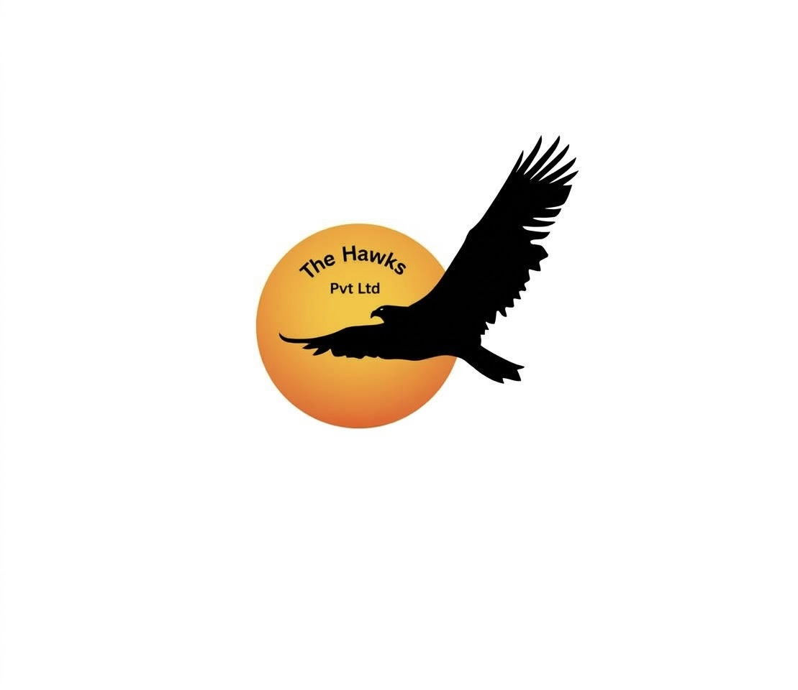
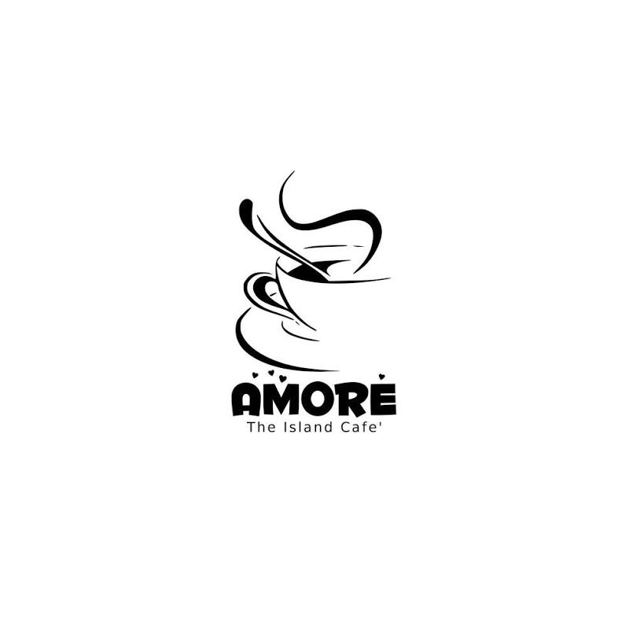

Welcome to Guraidhoo Island
<html lang="en">
<head>
  <meta charset="UTF-8" />
  <meta name="viewport" content="width=device-width, initial-scale=1.0" />
  <title>Ferry Schedule • Guraidhoo ↔ Male</title>
  
  <!-- Open Graph / Social Media Preview Meta Tags -->
  <meta property="og:type" content="website" />
  <meta property="og:url" content="https://hilleyapp.github.io/VisitGuraidhoo" />
  <meta property="og:title" content="Ferry Schedule • Guraidhoo ↔ Male" />
  <meta property="og:description" content="Check live ferry schedules, live tracking, weather, and onboard entertainment for Guraidhoo and Malé." />
  <meta property="og:image" content="https://hilleyapp.github.io/VisitGuraidhoo/preview.jpg" />

  <!-- Twitter Card Meta Tags -->
  <meta name="twitter:card" content="summary_large_image" />
  <meta name="twitter:url" content="https://hilleyapp.github.io/VisitGuraidhoo" />
  <meta name="twitter:title" content="Ferry Schedule • Guraidhoo ↔ Male" />
  <meta name="twitter:description" content="Check live ferry schedules, live tracking, weather, and onboard entertainment for Guraidhoo and Malé." />
  <meta name="twitter:image" content="https://hilleyapp.github.io/VisitGuraidhoo/preview.jpg" />

  <!-- Leaflet CSS -->
  <link rel="stylesheet" href="https://unpkg.com/leaflet@1.9.4/dist/leaflet.css"
        integrity="sha256-p4NxAoJBhIIN+hmNHrzRCf9tD/miZyoHS5obTRR9BMY="
        crossorigin="" />
  
</head>
<body>
  <header>
    <button class="theme-toggle" id="theme-toggle">🌙 Dark</button>
    <h1>Ferry Schedule</h1>
    
Guraidhoo ↔ Male ↔ Guraidhoo

    
🕒 Loading local time...

  </header>

  <!-- Weather Widget -->
  

    

      

        ⛅
        

          <strong>Guraidhoo Weather</strong>
          Scattered Clouds / Afternoon Showers
        

      

      

        
Temp: <strong>29°C</strong>

        
Wind: <strong>Gentle breeze</strong>

      

    

  

  

    

      

        <label>Route</label>
        <select id="direction">
          <option value="all">Both Routes</option>
          <option value="to-male">Guraidhoo → Male</option>
          <option value="to-guraidhoo">Male → Guraidhoo</option>
        </select>
      

      

        <label>Operator</label>
        <select id="operator">
          <option value="all">All Operators</option>
          <option value="escape">Escape</option>
          <option value="vmarine">V Marine</option>
          <option value="hawks">Hawks</option>
        </select>
      

      

        <label>Quick Search</label>
        <input type="text" id="search-input" placeholder="Search time or operator..." />
      

      

        <label>Day</label>
        

          <button class="day-btn all-btn active" data-day="all">All</button>
          <button class="day-btn" data-day="Sun">Sun</button>
          <button class="day-btn" data-day="Mon">Mon</button>
          <button class="day-btn" data-day="Tue">Tue</button>
          <button class="day-btn" data-day="Wed">Wed</button>
          <button class="day-btn" data-day="Thu">Thu</button>
          <button class="day-btn" data-day="Fri">Fri</button>
          <button class="day-btn" data-day="Sat">Sat</button>
        

      

    

  

  <main>
    

    
    <!-- Interactive Map -->
    

      <h2>Ferry Route Map</h2>
      

      

        <button class="sim-btn" id="sim-btn">▶ Simulate Ferry Trip</button>
      

      

         Malé
         Guraidhoo
         Ferry Route (~32 km)
      

    

    <!-- Live Tracking & Entertainment Grid -->
    

      <!-- Live Tracking -->
      

        <h2> Live Tracking</h2>
        

          <a class="live-btn escape" href="https://m.followme.mv/public/?s=ESCAPE" target="_blank" rel="noopener">
            
            
Escape<small>Queen · Wing</small>

          </a>
          <a class="live-btn vmarine" href="https://m.followme.mv/public/?s=V%20Marine" target="_blank" rel="noopener">
            
            
V Marine<small>V Marine 1-3</small>

          </a>
          <a class="live-btn hawks" href="https://m.followme.mv/public/?s=HAWKS" target="_blank" rel="noopener">
            
            
Hawks<small>Daisy · Ivy</small>

          </a>
          <a class="live-btn all" href="https://m.followme.mv/public/" target="_blank" rel="noopener">
            
✈

            
All Vessels<small>FollowMe map</small>

          </a>
        

      

      <!-- Onboard Entertainment / Live Stream -->
      

        <h2>📺 Onboard Entertainment</h2>
        

          <a class="tv-promo-btn" href="https://hilaytv.xyz/" target="_blank" rel="noopener">
            
            <strong>Enjoy Live TV while on the Go</strong>
            Stream your favorite channels & shows live on board
            Powered by HilayTV
          </a>
        

      

    

    

      

        
→ Guraidhoo → Male

        0 ferries
      

      

    

    

      

        
→ Male → Guraidhoo

        0 ferries
      

      

    

    <!-- Contact Ferry Operators -->
    

      <h3>Contact Ferry Operators</h3>
      

        <a class="contact-item escape" href="tel:+9607994699">
          
          
<strong>Escape</strong>+960 799 4699

        </a>
        <a class="contact-item vmarine" href="tel:+9607407777">
          
          
<strong>V Marine</strong>+960 740 7777

        </a>
        <a class="contact-item hawks" href="tel:+9607216816">
          
          
<strong>Hawks</strong>+960 721 6816

        </a>
      

    

    <!-- Buggy Service Booking -->
    

      <h3>🛺 Island Buggy Hiring Service</h3>
      

        <a class="contact-item buggy-item" href="tel:+9607994699">
          
🛺

          
<strong>Coming soon</strong>Ready to Book Your Ride

        </a>
      

    

    <!-- Cafés & Dining Section -->
    

      <h3>☕ Cafés & Dining</h3>
      

        <a class="contact-item dining-item" href="tel:+9607257878">
          
          
🍽️

          
<strong>Muranga Restaurant</strong>+960 725 7878

        </a>
        <a class="contact-item dining-item" href="tel:+9609888339">
          
          
☕

          
<strong>Amore - The Island Cafe</strong>+960 988 8339

        </a>
        <a class="contact-item dining-item" href="tel:+9607372999">
          
          
🍹

          
<strong>Chambao - Cafe & Retreat</strong>+960 737 2999

        </a>
        <a class="contact-item dining-item" href="tel:+9609663694">
          
          
🏝️

          
<strong>Thundi Cafe</strong>+960 966 3694

        </a>
      

    

  </main>

  <footer>
    Schedules may change without prior notice. Please confirm with the operator before travel.
  </footer>

  <!-- Leaflet JS -->
  

  
</body>
</html>
